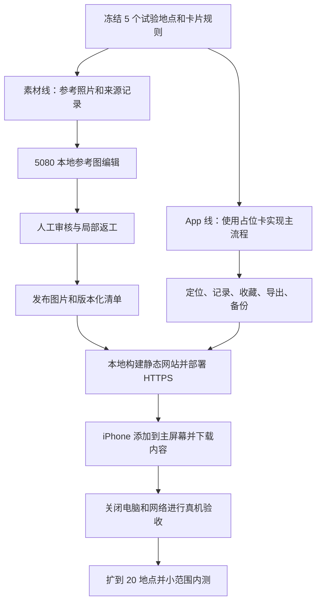

# Postcard：iPhone 免费 PWA MVP 制作 Pipeline

后续范围更新：2026-09-10 用户追加要求扩至 20 个城市；新增 19 城各 3 个地点、每地 3 张卡，墨尔本保留 20 地点。最新内容与交付说明见 [V0.4_WORLD.zh-CN.md](./V0.4_WORLD.zh-CN.md)。下文为最初单城实施基线。

版本 2.0｜2026-09-10｜状态：正在按计划实施；实际进度见 IMPLEMENTATION_STATUS.zh-CN.md

已确认平台：用户现有 iPhone；开发与生图设备为 Windows + RTX 5080。具体 iPhone 型号与 iOS 版本在实施前记录，不阻塞本次规划。

唯一首版交付路线：**Windows 本地开发和制作卡片 → 静态 HTTPS 托管 → iPhone Safari 打开 → 添加到主屏幕 → 下载城市内容 → 使用。**

本计划落实已有需求：Windows + RTX 5080，本地生成固定明信片，先跑通 MVP，再决定是否接商业 API。它是 PROJECT_PLAN.zh-CN.md 的具体执行方案；本轮以本文的范围与技术选择为准。

## 1. “免费”的交付边界

目标是 **不购买软件、不调用付费模型、不租业务服务器，使用免费静态托管制作 iPhone PWA 内测版**。PWA 是可添加到主屏幕的网页应用，本轮不做原生安装包。

前提是已有电脑、网络和 iPhone。电费、网络费、硬件和人力不是零成本；静态托管依赖供应商的免费方案及其限制，不承诺永久免费或无限流量。优先使用服务商提供的域名，不购买域名。

这轮不包含 App Store / TestFlight 发行、云端用户账号、云备份、在线地图、站内寄信和实时 AI。开发者需要静态托管账号，用户使用产品无需账号；不需要 Mac、Xcode 或 Apple Developer 付费会员。

最终交付必须是：**一个固定 HTTPS 地址和可添加到 iPhone 主屏幕的 PWA。在主屏幕入口完成离线下载后，关闭开发电脑、断网重开，仍能浏览已下载内容、手动记录、选卡、编辑、收藏与导出。** 首次打开及下载需要网络；定位失败时可补记，通过第三方聊天工具发图需要该工具自己的网络。浏览器存储可能被清理，必须提供备份和缺失内容恢复。

Apple 提供从 Safari 添加网页应用到主屏幕的操作方式。[Apple 官方说明](https://support.apple.com/guide/iphone/open-as-web-app-iphea86e5236/ios)

## 2. 冻结这轮 MVP

| 项目 | 本轮决定 |
|---|---|
| 覆盖范围 | 先 5 个地点验证，最终 20 个地点；优先选择团队能实测的同一城市 |
| 卡片数量 | 每地 3 张，最终 60 张 |
| 卡片类型 | 地标主体 / 环境氛围 / 文化细节 |
| 卡片风格 | 先比较两种样式，确定一种；后续保持一致 |
| 获取方式 | 主动 GPS 打卡或注明来源的手动补记；首次解锁三张 |
| 个人内容 | 地点、日期、最多 120 字短句、可选固定贴纸 |
| 收藏 | 按地点回看；重复旅行可制作新日期的卡 |
| 探索 | 离线地点示意图 + 附近列表 + 已访问状态 |
| 分享 | 导出图片、系统分享面板 |
| 数据 | IndexedDB 保存记录；Cache Storage 保存离线资源；备份文件导出与恢复 |
| 美术生产 | 本地 ComfyUI 和模型，人工审核后打包 |
| 明确后置 | 宠物旅行、好友系统、陌生人、轨迹迷雾、账号、付费 |

“免费完整 MVP”指上面这组功能可用且可靠，不代表同时实现产品所有远期想法。

## 3. 两条生产线与最终汇合



找照片与生成图片是两个环节。生图模型不会替我们检索互联网，也不能证明参考照片属于某个景点。首轮人工查找即可，先不写全网爬虫和自动打分系统。

素材线和 App 线可以由两个人同时做。App 使用固定清单格式读取图片，开发不需要等待全部美术完成。

## 4. 免费工具与依赖

| 工作 | 工具或方法 | 费用边界 |
|---|---|---|
| 本地图像生成 | ComfyUI 本地版 | 不使用 Comfy Cloud 或付费云节点 |
| 模型首选 | FLUX.2 [klein] 4B distilled，官方参考图编辑流程 | 本地权重；具体模型和组件许可证一并记录 |
| 参考照片 | 自有照片；逐项核验的 Wikimedia Commons 素材 | 无付费图库依赖，不把任意网上图片视为可用 |
| 小范围修图 | 已有免费本地工具，必要时使用 GIMP | 不以购买编辑软件为前提 |
| 批量导出和校验 | 小型本地脚本 | 实现缩略图、校验和、清单检查，非在线服务 |
| App | React + TypeScript + Vite，响应式 Web 界面 | Windows 本地构建，无原生构建服务 |
| 本地数据库 | IndexedDB，封装数据访问接口 | 无云数据库；不把卡图转成大段文字存进 localStorage |
| 离线 | Service Worker + Cache Storage | 控制页面、字体、卡图缓存及更新 |
| 位置 | 浏览器 Geolocation API | 前台 HTTPS 页面请求，无地点检索或地理编码 API |
| 图片导出 | Canvas 2D + Blob / File + Web Share 能力检测 | 失败时保留图片预览与保存入口 |
| 地图视觉 | 本地绘制地点示意图 | 无地图 SDK key、瓦片请求或地图免费额度 |
| 静态托管 | 首选评估 Cloudflare Pages Free，上传本地构建结果 | 使用默认 HTTPS 域名，只部署静态文件，不启用付费附加服务 |
| 代码和工作流管理 | 本地 Git | 远程代码托管可选，不是运行依赖 |
| 用户反馈 | 本地 Markdown 记录 + 人工访谈 | 不接在线埋点或客服平台 |

ComfyUI 提供 Windows 本地安装流程；模型教程提供文生图及图像编辑示例。安装时采用相互兼容的正式组件组合，不硬拼不同教程中的旧环境。[ComfyUI Windows](https://docs.comfy.org/installation/desktop/windows)、[模型工作流](https://docs.comfy.org/tutorials/flux/flux-2-klein)

Cloudflare Pages 支持直接上传已构建静态文件；当前免费方案有文件数等限制，单资源上限 25 MiB。卡图逐文件发布，不做超大单文件城市压缩包。实施时确认账号可用性和免费条件；若服务在实际网络中不可达，替换静态托管，不改变业务数据结构。[直接上传](https://developers.cloudflare.com/pages/get-started/direct-upload/)、[官方限制](https://developers.cloudflare.com/pages/platform/limits/)

## 5. 步骤 0：设备和项目准备

### 输入

现有 Windows 电脑、RTX 5080、一个能实测的城市、用户现有 iPhone。

### 操作

1. 确认 GPU 驱动、系统内存、磁盘余量，记录 iPhone 型号、iOS 版本和 Safari / 主屏幕模式表现。
2. 规划约 40–80 GB 可用磁盘作为开发预算，覆盖完整模型组件、依赖和候选图；这是预留建议，不是模型最低需求，也不需安装移动原生 SDK。
3. 系统内存建议 32 GB 或以上，实际设备尚未核验；生图时减少其他内存密集任务。
4. 创建源码、参考素材、候选图、正式资源和工作流的独立目录。
5. 确定 5 个地点：包含一个建筑、一个开放空间、一个细节丰富的景点；至少一个可以近期亲自到场。

### 输出与验收

- 环境清单：设备规格、工具版本、目录位置、测试手机。
- 5 地点清单，包含名称、别名、坐标来源和打卡半径。
- 不以购买服务解锁下一步。

## 6. 步骤 1：部署本地生成环境

### 操作

1. 安装 ComfyUI 本地环境，选择 GPU 推理。
2. 按官方 FLUX.2 [klein] 4B 工作流取得对应扩散模型、文字编码器和 VAE；不要只下单个权重就认为环境齐全。
3. 首次只加载官方图像编辑工作流，不叠加来历不明的整包节点、多个模型或复杂 LoRA。
4. 先完成一张普通图片的生成，再完成一张参考图的风格转换。
5. 记录实际模型文件、版本或哈希、工作流和运行日志。
6. 模型全部下载后断网再执行一次，确认没有隐含云端节点。

### 首测设置

- 4B distilled 版本；采用官方匹配权重与默认采样配置。
- batch size = 1，队列逐张执行。
- 约 1024 像素级，使用模型流程接受的尺寸；统一 3:2 卡面，例如 1152×768，具体是否采用以试跑为准。
- 一次先用一张参考图，不同时加入多参考、放大和额外控制模块。
- 固定种子用于比较，确认风格后再改变种子产出候选。

官方教程示例中 4B distilled 的显存占用约 8.4 GB；其速度是在 5090 上给出，不能换算为本机实测。5080 16 GB 是合理试验配置，但实际占用还受完整工作流、分辨率和其他程序影响。[ComfyUI 工作流](https://docs.comfy.org/tutorials/flux/flux-2-klein)

### 失败分支

| 问题 | 免费处理路径 |
|---|---|
| 显存不足 | 先确认单张、减少分辨率和参考图、关闭占显存程序，再调整卸载或匹配的低精度配置 |
| 组件不能运行 | 先核对官方模板和依赖版本，必要时重新建立干净环境；不无休止叠插件 |
| 图像编辑质量差 | 简化要求、更换角度明确的参考图、降低改动幅度 |
| 环境两天仍无法稳定跑通 | 暂用自有或条件明确的照片加统一边框打通 App，模型问题单独处理 |

### 输出与验收

一个能离线重复执行的工作流，连续完成 5 个单张任务；记录耗时、峰值显存和错误。此步骤没有承诺具体每张秒数。

## 7. 步骤 2：找参考照片与建立素材台账

### 推荐素材顺序

1. 自己拍摄且适合使用的照片。
2. 条件明确的 CC0 / 公共领域素材，逐项核对说明。
3. 可以落实署名等要求的素材；CC BY、CC BY-SA 等必须按具体条件处理。

Wikimedia Commons 每个文件有各自的使用条件，来源网站本身不等于统一授权。首轮为减少复杂度，优先自有或明确可用素材；找不到时换地点或使用普通纪念图，不要求先购买图库。[Commons 使用说明](https://commons.wikimedia.org/wiki/Commons:Reusing_content_outside_Wikimedia)

### 每个地点的操作

1. 用本地名、英文名和别名查找候选。
2. 保留 3–6 张参考图，覆盖地标、环境、细节；不是强行用一张照片推测三个真实角度。
3. 核对建筑特征、文件描述和地点名称，排除同名景点。
4. 保存可使用的原图、来源页、作者、许可地址与条件摘要。
5. 选定每类卡的参考图；没有可靠细节图时，调整构图，不编造文化元素。

### 素材台账字段

reference_id、place_id、category、source_page、author、license_name、license_url、retrieved_at、local_file、sha256、required_credit、review_status。

如素材要求在导出物中署名，导出的卡片也要有相应署名，不能只把信息放进开发目录或 App 关于页。AI 改图不自动消除参考素材的条件。

### 输出与验收

5 个地点的 15–30 张参考图及完整台账。坐标与图像来源分别核验；不能从生成图片中推断地理位置。

## 8. 步骤 3：定风格，再生成卡片

### 先定样，不直接量产

选 2 个地点，各试 2 种风格，每种 2 个候选，共 8 张。比较地标可辨认程度、画风一致性、手机尺寸观感和返工难度，选定一种。

先用温和的插画化风格作为候选，保留建筑结构；不要求模型同时改季节、天气、视角、人物和地标。实际样张决定最终方向。

### 固定输入规范

- 必须保留：建筑形状、关键结构、参考图中真实存在的重要元素。
- 可改变：色调、纸张感、笔触和有限的环境表现。
- 不让模型生成：城市名称、中文短句、日期、邮票文字。
- 不要求：根据地名凭空准确还原冷门建筑。

提示词骨架由“固定风格段 + 地点保留特征 + 当前卡片类别 + 允许改变内容”组成。具体提示词在试验时迭代，不把一条未经验证的提示词当最终配方。

### 5 地点小样批次

每地 3 类，每类先生成 2 个候选，总共 30 个候选，选出 15 个成品。某类都不合格时，改参考或提示词后补跑，不无限改随机种子。

### 20 地点正式批次

保持同一工作流，制作总计 60 张正式卡。若每卡先出 2 个候选，基线是 120 次生成；返工量另计。

制作时间估算公式：任务数 × 本机实测平均耗时 + 审核与修订。未经本机测试，不给“一小时做完整城市”的承诺。

### 每次任务保存

job_id、place_id、category、reference_ids、model_version、workflow_version、prompt、seed、dimensions、output_file、elapsed_seconds、review_status。

种子和工作流帮助复现，但不同硬件或依赖版本不保证逐像素一致，最终成品必须保存。

## 9. 步骤 4：人工审核、返工和输出

每张卡检查：

- 这是正确地点，主要地标结构没有画错。
- 三类卡有实际差别，没有靠重复裁切凑数。
- 没有混入别的城市建筑、乱写标识或错误文化元素。
- 风格、色彩、边距与其他卡一致。
- 手机预览时主体清楚，添加短句后仍可读。
- 参考来源与导出署名要求已处理。

状态为 candidate → approved / rejected。只有 approved 图片进入正式包；返工形成新版本，不覆盖已经打包的资源。

输出建议：保存无损制作母版，发布图使用 WebP 或经真机验证的合适格式；生成约 320 像素宽缩略图。发布图目标约 300–500 KB 是体积预算，不是强制压缩到牺牲质量。

最终 App 再绘制边框、地点、日期、短句和邮戳。这样改文字不需要重新生图，历史卡也可以编辑。

20 地点 × 3 卡 × 300–500 KB，发布卡面约 18–30 MB；离线下载还包括页面、字体和其他资源，界面按实际清单显示总大小。

## 10. 步骤 5：建立内容包契约

### 建议目录

```text
D:/new/postcard/
  app/                      # React PWA 源码、清单、Service Worker
  content/
    places.json             # 地点和坐标
    references.json         # 来源、署名与许可记录
    cards.json              # 卡片模板和发布图片引用
    approved/               # 已通过审核的发布图片
    thumbnails/             # 缩略图
  production/
    references/             # 参考原图
    candidates/             # 待审核图
    workflows/              # ComfyUI 工作流
    jobs/                   # 任务和审核记录
  tools/                    # 内容校验和打包工具
  releases/                 # 静态构建产物、版本清单与部署说明
```

这是计划目录，本次不创建实现代码。模型、参考原图、私人备份和候选图不进入网站发布目录；只发布网页和审核后的公共卡片资源。

### 内容契约

Place：稳定 place_id、城市、显示名、别名、经纬度、radius_m、简介。

CardTemplate：稳定 template_id、place_id、category、asset_version、图片、缩略图、署名信息。

内容 Manifest：content_version、最小 App 版本、资源数量、总字节数与文件校验值。另有 Web App Manifest，包含 name、稳定 id、start_url、scope、standalone 显示方式和图标；两份清单分别管理内容和主屏幕应用行为。

发布前校验：ID 不重复、坐标有效、每地正好三类已审核卡、图片存在、署名完整、引用无断链。失败时阻止打包。

## 11. 步骤 6：开发 App 主流程

### 页面

探索 → 地点详情 → 获得卡片 → 写短句 → 保存/分享；另有收藏和设置。

### A. 先用占位图打通

导入 5 个地点和占位卡，完成页面导航和本地记录。正式美术可以后替换，内容 ID 保持稳定。

### B. 免费离线探索图

使用地点坐标生成同一城市范围内的二维示意图，显示相对位置、地点名称和解锁状态；旁边有可排序的附近列表。

示意图不包含道路导航，不宣称精确比例地图、真实走路路线或探索面积；界面明确“地点示意图”。不从地图网站截屏或下载瓦片作为免费背景。

本轮用本地绘制替代原规划中的 MapLibre 在线底图接入，保留探索页面接口。未来要正式地图时再加入适用数据服务，不影响地点和打卡数据。

### C. 打卡与补记

点击打卡时请求前台定位，使用本地地点坐标判断距离，无需调用地理编码 API。初始半径 150–300 米、位置时效 30 秒、报告精度 100 米仅作试验参数，按实地结果调整。

实机定位通过正式 HTTPS 测试地址验证；iPhone 访问电脑的普通局域网 HTTP 地址只用于有限页面预览，不能当作安全上下文验收。定位是设备报告的位置，不保证始终由 GPS 单独提供。[Geolocation API](https://developer.mozilla.org/en-US/docs/Web/API/Geolocation_API)

遇到权限拒绝、信号差和超时，显示具体原因并允许手动记录。手动记录显示来源标签。无后台持续定位。

### D. 收藏、渲染与分享

首次到访解锁三模板；选一张创建包含日期和短句的个人卡。重访可新建实例，不重复计算模板解锁数。

渲染器输入为图片版本、地名、日期、短句、署名和版式版本；输出一张图片。首版只做一种稳定版式，长文字有预览和长度约束。

Canvas 直接绘制卡面与文字，等待图片和本地字体加载后导出，不依赖网页截图拼接。卡图和字体与网站同源，避免跨域素材导致画布无法导出。先使用约 1500×1000 的受控输出尺寸实测内存，不默认生成超高分辨率；每次完成后释放大图和对象 URL。

分成“生成预览”和“分享图片”两个动作：先生成 File，再由用户点击触发分享，避免漫长异步渲染丢失用户激活条件。先用 canShare 检测文件能力，支持才调用 share；否则显示完整图片并提供下载/保存指引。Safari 与主屏幕模式分别测试实际保存到照片或文件的路径，不承诺网页能静默写入相册。[Web Share API](https://developer.mozilla.org/en-US/docs/Web/API/Web_Share_API)

系统分享取消不显示“已寄出”；离线导出可用。站内寄信、收件箱和已读状态不属于此版本。

### E. 本地数据库与备份

IndexedDB 对象仓库至少包含 Visit、TemplateUnlock、Postcard、ContentPack 和本地设置。记录、解锁和卡片关联使用事务；按钮重试有唯一请求标识，防止双击重复保存。文字编辑自动保存草稿，不只依赖关页时保存。

原始 GPS 坐标只用于当前判断，默认不持续储存。保存地点、时间、时区和 gps/manual 来源即可。

提供备份导出/导入：包含数据库格式版本、旅行记录、卡片文字和不可变模板版本引用；不含模型和参考原图。通过分享/下载保存到 iPhone“文件”，通过文件选择器导入。提示用户这是手动备份，不是云备份；清理网站数据前需自行导出。

导入先检查文件大小、格式版本和字段，再在事务中合并；相同 ID 且内容相同跳过，内容冲突保留副本，失败不破坏旧记录。JSON 备份不包含卡图，恢复后需要重新下载对应内容版本；单独导出的图片提供独立纪念副本。

### F. 离线下载、存储与版本更新

1. Service Worker 缓存最小页面、脚本、图标和必需字体；启动不依赖外部字体、分析脚本或在线图片。
2. 用户在主屏幕应用中点击“下载城市”，按版本清单将卡图存入暂存缓存，显示进度、实际大小、失败重试和完成状态。
3. 图片逐项校验，全部完成后才把内容包标为 ready；中断时保留已完成项目，下次前台打开继续，不承诺锁屏后台下载。
4. 本地记录与可重新下载的资源分开；用户清理内容缓存不会同时删除旅行记录。检测浏览器存储不足时说明原因，不静默吞掉写入错误。
5. 每次进入验证必需缓存；缺失时展示重新下载入口，仍保留能读取的文字记录。只有实际资源完整才显示“可离线使用”。
6. 对支持的浏览器尝试查询存储配额和申请持久存储，失败时照常提供备份；持久存储申请不保证批准，也不抵御用户主动清除数据。[WebKit 存储政策](https://webkit.org/blog/14403/updates-to-storage-policy/)
7. 图片 URL 带不可变版本，旧卡引用的旧版本继续保留在发布目录。新版内容校验成功后切换；失败保留旧版。
8. App 检测更新后提示保存草稿并重开，不在编辑中强制刷新。先完成向后兼容的数据迁移；不得把回滚网页文件当成自动回滚数据库。

### G. Safari 与主屏幕入口

先引导用户添加到主屏幕，再在主屏幕入口下载内容、建立正式收藏。不能假定 Safari 中的数据和下载缓存会自动搬到主屏幕应用；需要时用备份导入转移。WebKit 官方说明新增主屏幕应用的存储隔离行为。[WebKit Safari 17.2](https://webkit.org/blog/14787/webkit-features-in-safari-17-2/)

页面适配 iPhone 安全区域、软键盘、动态视口、触摸目标和系统文字大小。部署前固定正式 origin；测试域名与正式域名的 IndexedDB 不共用，迁移时提供导出/导入路径。

## 12. 步骤 7：构建静态网站并交付到 iPhone

1. 第一个技术里程碑就制作可用 HTTPS 测试页，在现有 iPhone 验证定位、图片导出、IndexedDB 和 Service Worker；先解决兼容问题再批量加功能。
2. Windows 本地构建 production 静态文件，锁定依赖，校验内容；版本同时记录 app_version、content_version、schema_version。
3. 只上传构建目录，排除模型、参考原图、私人短句、备份及工具密钥。审核后的公共卡片可被访问，私人的旅行记录仅留在设备；托管方仍能看到正常网站请求等服务日志。
4. 使用 Cloudflare Pages Free 的 Direct Upload 路径和默认 HTTPS 域名，不启用 Functions、付费存储或自定义域名。部署前再核验实际账号条件；只有计划，不在本次注册、上传或发布。
5. 配置 manifest、图标、apple-touch-icon 和 Service Worker 的正确路径与作用域。应用页面使用简单稳定路由，保证直接进入和离线重开都有匹配的页面缓存。
6. 更新清单和 Service Worker 允许重新校验，带版本图片长期缓存。保存上个静态构建产物，并验证正常更新及失败恢复。
7. iPhone 用 Safari 打开固定网址，分享菜单添加到主屏幕；从主屏幕图标启动，下载城市包，确认全部完成。
8. 关闭电脑，退出应用，切到飞行模式后重开，验收完整离线流程。

输出：固定 HTTPS 访问地址、静态构建文件、内容与应用版本清单、主屏幕添加说明及已知限制。

验收证明：不需要开发电脑、ComfyUI 或用户账号常在线；首次访问和重新下载依赖托管服务可达，下载后的离线能力以真机测试为准。不依赖 Safari 必定弹出自动“安装”提示，使用明确的手动添加说明。

## 13. 步骤 8：真机验证和内测

### 技术验收

| 测试 | 通过条件 |
|---|---|
| 真正离线 | 在主屏幕入口完成下载后，关闭电脑、退出应用、飞行模式重开，能浏览、手动记录、收藏、编辑和导出 |
| 实地定位 | 到访至少一个真实地点，正常定位可打卡，边界和弱信号可合理恢复 |
| 拒绝权限 | 无定位权限也能正常浏览和补记，不死循环弹窗 |
| 连续点击 | 同一操作重复点击不产生意外重复卡或解锁 |
| 重启与升级 | 重开 PWA 和同域名版本更新后记录保留，编辑中不强制刷新 |
| 图片与文字 | 60 张卡均可打开；长地名、中文、emoji 和署名不被裁掉 |
| 分享取消 | 取消后仍能编辑，不显示已发送 |
| 备份恢复 | 导出、恢复、重复导入、缺失内容引用有明确结果，不破坏旧数据 |
| 演示数据 | 模拟位置入口只在开发配置可用，不混入正式足迹 |
| 添加主屏幕 | 图标、启动页、独立显示正常；Safari 已有记录可经备份转移 |
| 缓存不完整 | 下载中断、锁屏、空间不足均可恢复；没有假报“已可离线” |
| 数据隔离 | 换入口/测试域名时不误报数据丢失，给出明确迁移方法 |
| 分享兼容 | Safari 和主屏幕入口分别验证分享、图片预览、保存到文件与取消 |
| 清理恢复 | 仅用测试数据验证缓存清理/存储缺失，备份能恢复记录并重下资源 |
| 手机布局 | 刘海/底部安全区域、软键盘、长短句和系统大字模式可操作 |

### 产品内测

先以用户现有 iPhone 的系统版本为首个支持基线，再邀请 5–10 位有 iPhone 的朋友，通过链接和主屏幕添加说明测试，记录型号与系统版本。实际测试前不宣称所有 iOS 版本兼容。首次使用观察是否能独立完成一张卡；询问愿不愿意保存、分享和下次再用。

记录四类反馈：阻断错误、卡面质量、操作困惑、扩展需求。先修阻断和卡面问题，再考虑加功能。

不使用调起分享次数冒充真正发送数量，也不拿没有第二次出游机会的用户判断留存。

## 14. 任务顺序和预计投入

| 阶段 | 预计投入 | 里程碑 |
|---|---|---|
| 准备与本地模型试跑 | 1–2 人日 | 离线连续产出 5 张图 |
| 参考图与风格试验 | 2–3 人日 | 选定风格和 5 地点参考 |
| 5 地点卡片制作 | 1–2 人日 | 15 张通过审核 |
| PWA 技术验证 | 3–4 开发人日 | iPhone HTTPS 页面走通定位、导出、离线重开 |
| PWA 主流程和数据 | 10–14 开发人日 | 定位、收藏、编辑、备份、缓存和更新完整 |
| 扩充到 20 地点 | 2–4 内容人日 | 60 张正式卡和内容清单 |
| 部署、实测和修复 | 5–7 开发人日 | 主屏幕 PWA、离线与存储/分享异常通过 |
| 缓冲 | 4–6 开发人日 | 消化依赖、排版和设备问题 |

App 部分约 22–31 开发人日，加上环境、内容协作与整合，建议仍按 **约 6–8 周全职开发节奏** 安排；内容约 5–9 人日，熟练程度和返工会影响结果。两人可重叠工作，不是简单相加，也不是有两个人工期就减半。

如果一个人包办全部，需要把内容制作加进自己的日历。若每周只有 20 小时开发时间，仅 App 部分就约 9–13 周，另加不能重叠的内容和准备时间。

最先交付的不是 60 张图，而是 **一张卡在真实手机上的完整体验**。如果工期紧，可以先以 5 地点作为体验验证版；20 地点是此计划的完整内测范围。

## 15. 自动化做到什么程度

首轮人工处理：选地点、找照片、核对来源、选定画风、审核地标。

小样成功后自动化：按任务清单排队生成、记录工作流参数、缩略图和压缩、引用检查、内容打包。

后续再考虑：自动图库检索、视觉分类、相似图去重、批量质量打分。这些能力不会自然包含在生图模型里，且不应阻塞 5 地点样机。

生成任务允许继续使用 ComfyUI 界面队列；需要脚本时，只调用本机服务处理预设任务，不把电脑开放为公网生成端点。

## 16. 成本清单和 API 迁移条件

| 项目 | 本方案新增服务费用 |
|---|---:|
| 生图 API、GPU 租赁 | 0 |
| 业务服务器、云数据库、独立对象存储 | 0；本轮不采用 |
| 静态 HTTPS 托管 | 使用免费方案范围，默认域名；部署时核验限制 |
| 地图和地点检索 API | 0 |
| 云构建、商店发行 | 0；本轮不采用 |
| 模型/开源工具使用 | 0；遵循各组件许可 |
| 自有或符合条件的免费素材 | 0 |
| 电费、网络、设备、人力 | 自行承担，不计入“零服务费” |

以后考虑商业 API 的触发条件：本地模型达不到卡面质量、实际制作耗时影响更新，或用户需要实时个性化。不要只因 MVP 完成就强制迁移。

迁移时只替换制作端：参考输入 → 本地或商业生成 → 同样的审核 → 同样的成品和清单。App 不关心图片由哪种模型生成。若变为用户实时生成，才另加服务端任务、鉴权和成本额度；那是新阶段，不是本轮隐藏依赖。

## 17. 最终交付检查表

- [ ] 可离线重复运行的本地模型工作流和版本记录。
- [ ] 20 个地点、60 张审核完成的正式卡片。
- [ ] 参考素材来源、许可与署名记录。
- [ ] React PWA 源码、依赖锁定、IndexedDB 迁移和内容校验工具。
- [ ] 固定 HTTPS 地址、静态构建产物和主屏幕添加说明。
- [ ] Service Worker、可验证的城市下载状态及更新/中断恢复。
- [ ] 数据备份与恢复功能。
- [ ] 关闭电脑、完成下载后无网重开的 iPhone 真机测试记录。
- [ ] 5–10 人内测反馈与下一轮优先级。

完成这些才算本轮 MVP 完成；“模型能出图”或“电脑上能打开页面”只是中间节点。

## 18. 官方依据与不确定性

- [ComfyUI Windows 本地安装](https://docs.comfy.org/installation/desktop/windows)
- [ComfyUI FLUX.2 klein 工作流](https://docs.comfy.org/tutorials/flux/flux-2-klein)
- [FLUX.2 klein 4B 官方模型卡](https://huggingface.co/black-forest-labs/FLUX.2-klein-4B)
- [Apple 主屏幕网页应用](https://support.apple.com/guide/iphone/open-as-web-app-iphea86e5236/ios)
- [浏览器定位](https://developer.mozilla.org/en-US/docs/Web/API/Geolocation_API)
- [Web Share API](https://developer.mozilla.org/en-US/docs/Web/API/Web_Share_API)
- [WebKit 存储政策](https://webkit.org/blog/14403/updates-to-storage-policy/)
- [Safari 与主屏幕数据隔离](https://webkit.org/blog/14787/webkit-features-in-safari-17-2/)
- [Cloudflare Pages 上传](https://developers.cloudflare.com/pages/get-started/direct-upload/)
- [Cloudflare Pages 限制](https://developers.cloudflare.com/pages/platform/limits/)
- [Wikimedia Commons 素材复用说明](https://commons.wikimedia.org/wiki/Commons:Reusing_content_outside_Wikimedia)

本计划最初按 2026-09-10 查阅的官方资料编写。用户随后授权实施，已完成本地环境、五地点试验卡面和 Pages 试验版部署；最新实测证据见 IMPLEMENTATION_STATUS.zh-CN.md，iPhone 操作见 IPHONE_TEST.zh-CN.md。计划中的完整城市包数量与工期仍属于目标，不代表已经完成。
