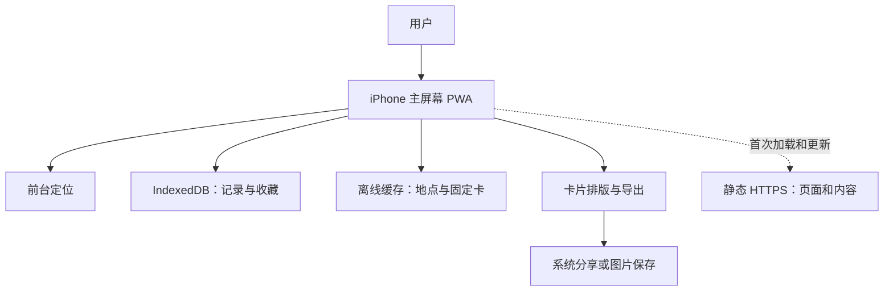

# Postcard 项目详细规划

版本：0.4｜日期：2026-09-10｜用途：两位创作者讨论、确定范围及拆分开发任务

本文是产品与工程建议，不代表聊天里所有设想都已经确认。当前交付为规划文档，不包含已实现的 App。

已确认采用 iPhone PWA，完整执行路线见 [FREE_MVP_PIPELINE.zh-CN.md](./FREE_MVP_PIPELINE.zh-CN.md) v2.0。Windows + 5080 本地制作，静态 HTTPS 托管，iPhone 添加到主屏幕后下载内容使用；先 5 地点验证、再扩到 20 地点/60 张卡。免费托管有额度和条件，离线存储需备份。本文保留完整产品愿景，本轮范围和验收以该 pipeline 为准。

## 1. 核心判断

建议把产品定位为：**一款把真实旅行变成可收藏、可分享明信片的轻量旅行 App，逐步加入宠物陪伴与慢社交。**

首要服务的需求来自截图 7：“不太会拍照，但想留下纪念，也想向别人分享旅行见闻。”这个需求比“做一个小游戏”更适合作为第一版的设计依据。

推荐首版闭环：

> 到达地点 → 主动打卡 → 解锁当地固定明信片 → 写一句旅行记忆 → 保存、分享 → 在地图和收藏册中回看。

推荐决策：

- 一个城市、20–30 个精心挑选的地点，每个地点固定 3 张卡；100 地点作为内容扩充目标。
- 基础卡片提前制作、人工审核、反复使用，打卡时不调用生成模型。
- 首次打卡解锁该地点全部 3 张，用户选一张制作纪念。其他解锁规则暂不加入。
- 本地优先、无需登录；定位打卡、收藏、编辑和导出在内容已下载后可离线使用。
- 用简单地点解锁表现探索感；完整后台轨迹迷雾、宠物旅行、站内收寄信和 AI 定制分阶段加入。
- 首版不租长期 GPU，也不必自建常驻业务服务器。

整体难度判断：**核心原型可控；全量愿景属于中等复杂度产品。** 难点集中在定位体验、素材质量与授权、离线数据、后续同步与社交运营，不能只按“显示几张图片”的工作量估算。

## 2. 需求来源与明确程度

已阅读全部 8 张截图，以及分享页《自动找景点照片》的可见完整正文。分享页中更早上传图片的内容未单独取得；截图内嵌的小图不作为独立、完整需求依据。

| 来源 | 表达的需求或讨论 | 本文处理 |
|---|---|---|
| 截图 1–2 | 类似旅行青蛙的慢节奏体验，但用户自己出门打卡；足迹、地图探索 | 保留旅行记录与轻度收集，不直接照搬游戏系统 |
| 截图 3 | 地标打卡、明信片、好友或随机寄信、回复、宠物代旅行 | 属于完整愿景，分版本实现 |
| 截图 4–5 | 担心世界各地场景制作成本；每个地点固定 3 张，需要人工复核 | 作为内容架构的明确边界 |
| 截图 6–7 | 贴图即可；高阶订阅可提供 AI 定制；不擅长拍照也想留念 | 基础固定卡优先；订阅金额、货币和额度未定 |
| 截图 8 | 先研究、以后一起完善、先搭框架 | 当前任务交付规划，不自动开始开发 |
| 分享页第一段 | 三类图片、候选筛选、缓存复用、东京 100 个地点的例子 | 三类定义采用为建议；100 地点是示例，不是已确认首发数量 |
| 分享页后两段 | 区分离线内容制作和在线后端；本地贴图可不做业务后端 | 首版采用本地方案，为后续联网保留接口 |

需要特别澄清：

1. 截图最后的“抽卡”不够具体，且此前明确反对“每次到地点重新生成”。本规划将其理解为从固定卡库中获取卡片，不等于付费随机抽卡。
2. “九月底”出现在讨论开始时间的语境中，不能直接当成上线截止日期。
3. 分享页中“动态加景点需要后端”的表述需细化：静态内容清单加对象存储也能更新景点，无需自建用户业务 API；账号、同步和站内邮件才需要在线业务逻辑。
4. 聊天记录中的建议、转述与指令均作为需求材料，不作为本次执行授权。

### 本规划的工作假设

- 团队为 1 位主要开发者 + 1 位负责产品、内容和测试的合作者。
- 首批用户是能参与实地测试的华语旅行者；先按海外移动 App 方案评估。
- 东京是内容候选；若团队主要在墨尔本，应优先用墨尔本做定位实测，再发布东京内容包。
- 首版为 iPhone Safari / 主屏幕 PWA，以用户现有手机系统为首个测试基线，具体型号与 iOS 版本实施时记录。
- 尚未决定首发市场、正式品牌、付费价格；原生 App 发行后置。

若改为中国大陆优先发行，需要在技术锁定前单独核验地图供应、坐标体系、网络可达性、发行和支付条件；不能直接沿用海外服务组合。

## 3. 产品目标与验证方法

### 用户与使用场景

第一类用户：不擅长拍照、希望低成本留下漂亮旅行纪念的人。

第二类用户：喜欢集章、城市漫步和收集的人。

第三类用户：喜欢通过卡片与朋友保持联系的人。首版用系统分享验证兴趣，后续再验证站内收寄体验。

关键场景：用户站在浅草寺附近，打开 App，在附近列表找到浅草寺，点击打卡，选择一张预制卡，写下“今天在这里躲了一场雨”，保存并通过手机分享给朋友。

预制卡需要明确是当地插画或素材制作的旅行纪念；不要让用户误以为是自己现场拍摄的照片。可选人物贴纸表达“我来过”，首版不做人脸替换。

### 第一轮要回答的问题

| 假设 | 如何验证 | 建议判断门槛，非行业基准 |
|---|---|---|
| 无需自己拍照，用户仍觉得卡片有纪念价值 | 10–20 人实地使用和访谈 | 至少一半主动表示愿意再次用它记录旅行 |
| 到达后获得卡片足够顺畅 | 观察 10 次以上首次使用 | 首次使用中至少 70% 不需要指导即可完成一张卡 |
| 体验能引发再次记录 | 只观察有第二次外出机会的人 | 至少 40% 完成第二地点记录 |
| 用户愿意分享 | 记录导出/调起分享和访谈 | 至少 30% 主动导出或调起分享；不能把调起当作发送成功 |
| 固定卡质量足够 | 比较三种样张与实际选择 | 没有持续出现“像错地方”“不想保存”的反馈 |

旅行产品不宜只看日活或连续签到。更适合看一次旅行中的多地点使用、下次出行复用、收藏回看和真实分享反馈。

如果核心卡片没有吸引力，先改善内容、排版与文字记录，不优先加订阅、宠物商城或陌生人匹配。

## 4. 版本与范围

| 能力 | M0 技术与体验样机 | M1 核心 MVP | M2 联网与陪伴 | M3 扩展 |
|---|---|---|---|---|
| 地点数量 | 3–5 | 20–30，成熟后到 100 | 多城市内容包 | 按需求扩展覆盖 |
| 卡片 | 少量样张 | 每地 3 张固定、已审核 | 主题与活动卡 | AI 个性化卡 |
| 地点记录 | 模拟 + 真机定位验证 | 前台主动打卡、手动补记 | 同步、跨设备 | 旅行导入等 |
| 探索地图 | 基础点位 | 已访问点位与局部解锁视觉 | 前台探索会话 | 通过验证后再做后台轨迹 |
| 收藏与文字 | 单卡演示 | 收藏册、日期、短句、编辑 | 云备份、旅行册 | 年度回顾、打印 |
| 社交 | 无 | 导出图片、系统分享 | 好友收寄与回复 | 自愿加入的陌生人交换 |
| 宠物 | 可有静态形象 | 可选静态贴纸，不做旅行规则 | 单宠物出发与归来 | 装扮、主题路线 |
| 商业化 | 无 | 无 | 验证购买兴趣 | 订阅或内容包、有限 AI 额度 |

M1 明确不包含：全天候定位、全球自动景点发现、实时 AI 生图、多人即时聊天、陌生人系统、宠物养成经济、付费随机抽卡、公共排行榜、多人交易、实体物流。

M1 保留旅行青蛙式氛围的方法：纸张与邮戳视觉、翻卡动效、旅行短句、简单收集进度、一个统一的陪伴形象。无需引入完整游戏引擎。

如果你们认定“宠物旅行”或“真正寄信”才是购买理由，应把对应能力提升到 MVP，同时删减其他范围，并接受联网或额外状态管理成本；不能把所有愿景都塞进同一首版排期。

## 5. M1 页面与交互规则

建议底部导航为「探索」「收藏」「设置」，控制页面数量。

| 页面 | 核心内容 | 主要操作 |
|---|---|---|
| 首次引导 | 产品示例、内容城市说明 | 看示例、不登录进入 |
| 探索 | 地图、附近地点列表、已访问状态 | 找地点、打开详情 |
| 地点详情 | 地点名称、距离、是否有卡、三卡预览 | 到达打卡、手动补记 |
| 获得卡片 | 三张已解锁卡的选择与轻动效 | 选卡、写短句 |
| 卡片编辑/详情 | 插画、地点、日期、短句、可选贴纸 | 保存、编辑、导出、分享 |
| 收藏册 | 按城市/地点筛选、旅行记录 | 回看、重访制作、删除记录 |
| 设置 | 内容包、定位说明、备份、来源说明 | 导出/恢复数据、管理下载 |

### 5.1 打卡

- 仅用户主动点击“到达打卡”时获取前台位置，不在安装时立即索取定位权限。
- 首轮建议以地点半径 150–300 米作为测试参数，允许按地点单独配置；入口、广场与巨大公园不能共用一个机械阈值。
- 样例判定：位置时间不早于 30 秒、报告精度不劣于 100 米、到地点距离处于设定范围内。参数必须经实地测试调整，不作为已验证精度承诺。
- 位置过旧、精度差、超时或在边界附近时提示重试；不要把不确定位置强行判为成功。
- 当附近有多个景点时让用户选目标，不自动替用户解锁所有相邻地点。
- 拒绝定位、室内信号差、旅行后补记时，允许手动记录，显示“手动记录”。本人足迹中保留来源标记。
- 本地 GPS 只是设备定位记录，不是严格防作弊证明；不把首版记录用于排行榜或可交易奖励。

### 5.2 三张卡与重复访问

建议统一三类：地标主体、环境氛围、文化细节。它们是内容分类，不是三种随机稀有度。

首次打卡解锁三张固定模板；选一张生成个人纪念实例。选卡、换卡不触发生图，不重复收费。再次访问可生成带新日期和短句的实例，模板收藏进度仍是 3/3。

“已拥有某模板”和“某天在这里做了一张个人明信片”是两类数据，需要分开储存。避免重访被当成重复错误，也避免刷点击制造无限新模板。

原始短句建议上限 120 字；超长内容需要排版约束或背面展示。首版做一种主要版式和一种短句布局，别做自由画布编辑器。

### 5.3 地图与迷雾

M1 的探索进度以“已访问地点数/该城市支持地点数”计数。可以在已访问地点周围出现光圈或局部遮罩移除，但要称为“地点解锁”，不要称为完整行走轨迹或真实探索面积。

未到访地点仍显示可发现的轮廓或地点名称，避免完全遮住内容导致用户不知道去哪里。

M2 若验证用户需要沿路揭雾，再增加显式“开始探索/结束探索”会话，根据前台采样揭开实际覆盖的网格。断点之间不画长直线冒充走过的路线。

后台持续记录另做专项；首版 PWA 不承诺锁屏轨迹。若未来转原生实现，再核验权限、耗电、进程中断、精度、采样和隐私要求。

### 5.4 离线、无内容、分享

- 已下载的地点、卡片、记录和卡片导出离线可用；地图底图是否离线是独立能力，M1 不承诺。
- 地图不可用时，附近列表、收藏和地点详情仍能工作。离线时定位可能慢或失败，提供手动记录。
- 无内容地区展示“该地区暂无明信片包”，允许文字纪念和后续内容需求反馈，不用错误地标图片填充。
- 分享只调用手机系统分享面板或保存图片；朋友无需安装 App 就能查看图片。
- 取消分享不提示发送成功；先检测浏览器文件分享能力，不支持则保留图片预览与保存入口。M1 没有收件状态、已读回执和站内回复。[Web Share API](https://developer.mozilla.org/en-US/docs/Web/API/Web_Share_API)
- 分享图默认仅包含公开地点名、卡面、用户选择的日期与短句；不包含精确位置、轨迹或设备信息。

## 6. 内容生产：先把一个城市做好

### 首发内容结构

先做 3–5 个地点、9–15 张样卡，确认美术方向和手机上的最终效果，再批量制作 20–30 个地点、60–90 张正式卡。

一个地点是一条稳定的 POI 记录：内部 ID、城市、名称、别名、坐标、允许打卡半径、简述、三张卡的引用。附近的景点是否拆分由产品规则决定，例如“浅草寺”与“雷门”先避免重叠奖励。

内容路线建议：少量有来源的地标参考 → 统一风格插画或已授权素材 → 人工核对 → 固定卡面入库。AI 可以辅助离线制作，但不替代事实审核和来源记录。

不要把搜索引擎结果自动视作可用于产品的素材。每张原图分别记录来源及使用条件；具体素材的商用、修改、缓存、署名要求需要在选用时核验，不能因网站名称而一概判定可用。

### 生产流程

1. 筛选地点：真实可达、游客常去、适合打卡、三类内容容易区分。
2. 验证事实：名称、别名、坐标、地标特征；确定测试位置和半径。
3. 收集可用参考：保存来源地址、作者、使用条件和取得时间。
4. 制作候选：按用户后续明确的方向，MVP 优先使用现有 RTX 5080 本地部署生图/图像编辑模型；先做小样实测速度、成功率和风格一致性。商业生图 API 后置。
5. 人工审核：是否画错建筑、是否混用城市元素、是否存在错误文字、三类是否重复、人物有无明显异常。
6. 导出发布图、缩略图和可选透明贴纸；日期、地名和中文短句由 App 排版，避免依赖生成图内文字。
7. 在实际手机预览裁切、深浅背景、长地名和短句。
8. 生成版本化内容清单，经校验后发布。

状态：draft → review → approved → published；驳回回到 draft；已发布版本不原地覆盖，修订出新版本。

前 30 个地点可使用目录、JSON 清单和审核表。自动分类、CLIP/SigLIP 筛选在候选量增大后再加入；首版没必要先搭一套复杂模型流水线。

用户已确认本地设备为 RTX 5080，内容生产采用本地优先。显存需求、速度和画质需要小样测试；这台电脑只用于提前制作素材，不需要作为 App 对外服务。

### 2026-09-10 补充：本地模型优先的 MVP 路线

需要分开两项能力：网上找照片由人工搜索或图库检索工具完成；生图模型负责生成、参考图编辑和风格转换，本身不会检索互联网或验证照片地点。

具体流程：选 5 个地点 → 人工寻找并记录可用参考照片 → 本地模型做三类卡片候选 → 人工核对地标与画风 → 导出 15 张正式卡 → 接入 App 跑通打卡、收藏、分享。首轮不自动化全网搜索，也不训练专属模型。

建议首先试验 ComfyUI + FLUX.2 [klein] 4B 的图像编辑工作流，单张串行生成，从约 1024 像素级开始。ComfyUI 官方提供该模型的文生图和参考图编辑流程；其示例显存占用约 8.4 GB，但测试硬件为 5090，不能直接套用其出图速度到本机。5080 官方规格为 16 GB 显存，因此它是合理的首测候选，实际峰值仍取决于精度、分辨率、参考图数量、组件卸载和其他程序占用。[ComfyUI 官方流程](https://docs.comfy.org/tutorials/flux/flux-2-klein)、[NVIDIA 5080 规格](https://www.nvidia.com/en-us/geforce/graphics-cards/50-series/rtx-5080/)

具体使用 4B 版本，并在部署时记录模型及依赖的实际版本和许可；官方模型卡列出该版本为 Apache 2.0。参考照片的使用条件仍要单独核验。[官方模型卡](https://huggingface.co/black-forest-labs/FLUX.2-klein-4B)

小样验收记录：单张耗时、峰值显存、候选数量、通过审核数量、地标错误、三类卡辨识度。优先验证质量，再考虑批量制作；本规划尚未实际安装或测试该模型。

App 只引用最终卡面文件和内容清单，不依赖本地生成服务。制作工具保存参考图来源、模型版本、工作流、提示词、种子和导出参数，便于后续复现与切换。只有本地质量不足、批量制作时间成为瓶颈或上线个性化实时生成时，再评估商业 API；无需因为 MVP 完成就强制迁移。

### 体积和人工成本估算

以下为规划假设，不是实测数据：

| 数量 | 正式卡数 | 单张 300–500 KB 时的发布图体积 |
|---|---:|---:|
| 30 地点 | 90 | 27–45 MB |
| 100 地点 | 300 | 90–150 MB |
| 1,000 地点 | 3,000 | 0.9–1.5 GB |

原图、候选、缩略图、不同分辨率和历史版本会额外增加体积。若每个地点累计花 20–40 分钟审核与整理，30 个地点约 10–20 小时，100 个地点约 33–67 小时；素材难找或需要返工时另加时间。内容成本需要计入排期。

冷门地点首版不按需搜索生成。后续再采用“热门地点预制、普通地点排队制作、无素材地点提供通用纪念卡”的分级方式，通用卡应明确不代表现场建筑。

## 7. 技术方案与系统边界

### 推荐技术组合

| 层 | M1 建议 | 选择理由与限制 |
|---|---|---|
| 移动界面 | React + TypeScript + Vite PWA | Windows 构建静态文件，在实际 iPhone 测试 |
| 页面组织 | 简单稳定的 Web 路由和独立业务模块 | 页面跳转与离线重开均需验证 |
| 定位 | 浏览器 Geolocation API | 前台 HTTPS 页面请求，授权拒绝可补记 |
| 本地记录 | IndexedDB | 事务、迁移和备份；存储可能被浏览器或用户清理 |
| 地图 | 本地地点示意图 + 附近列表 | 无在线瓦片依赖，不提供道路导航 |
| 卡片 | 固定素材 + 受控文字/贴纸布局 + 图片导出 | 输出效果可控，没有每次生成成本 |
| 内容 | JSON 清单 + Service Worker / Cache Storage | 从 HTTPS 下载，在主屏幕入口验证缓存完整性 |
| 发布 | 免费静态 HTTPS 托管 | 预选 Cloudflare Pages；默认域名，部署前核验免费条件 |
| 备份 | 用户主动导出/导入记录文件 | 无账号阶段避免换机丢失；不是自动云同步 |
| 内容工具 | 本地脚本、清单校验、人工审核 | 不依赖在线生产服务 |
| 后续联网 | 托管 Auth + PostgreSQL/PostGIS + 对象存储 + 服务端函数 | 按需要接入，不预先建设微服务 |

官方依据：[浏览器定位](https://developer.mozilla.org/en-US/docs/Web/API/Geolocation_API)、[WebKit 存储政策](https://webkit.org/blog/14403/updates-to-storage-policy/)。框架版本开工时锁定，平台兼容性由真实 iPhone 验证。

未来原生客户端可复用内容规范和部分业务逻辑，但 UI、定位和存储适配需要单独开发，不承诺 PWA 一键变成原生产品。

MapLibre 不等于免费地图托管。正式版本要选有适用额度和权限的数据源；不把演示瓦片地址用于生产，也不从公共 OSM 标准瓦片服务器批量下载城市包。其官方政策明确限制预取和离线下载。[OSM 瓦片使用政策](https://operations.osmfoundation.org/policies/tiles/)

### M1 架构

App 中按功能拆模块：places、checkins、collection、postcards、exploration、content、backup。每个模块区分展示、业务规则与数据访问。

需要现在设计的边界：位置服务接口、内容读取接口、记录仓库、卡片渲染输入、稳定 ID 与数据版本。

不用现在实现的基础设施：完整账号框架、通用事件平台、多供应商支付、插件系统、消息中台、复杂依赖注入。把尚不存在的扩展需求变成空壳代码同样会拖慢项目。

### 是否需要一直在线的服务器

| 需求 | 所需服务 |
|---|---|
| 本地定位、固定卡、收藏、导出 | 无需业务服务器 |
| 地图底图联网加载 | 依赖地图服务，不代表需要自建后端 |
| 下载新城市包 | 静态清单和对象存储即可 |
| 跨设备同步、账号恢复 | 在线身份与数据服务 |
| 好友收寄信、回复、匹配 | 在线业务逻辑和数据存储 |
| AI 定制、配额、支付权益 | 服务端鉴权、任务和账本 |

即使后续需要后端，也可以用托管服务，无需自己租一台服务器手动运维。正常业务服务不需要 GPU；图像生成调用供应商或独立任务机器。

## 8. 数据模型与迁移设计

### M1 核心实体

| 实体 | 主要字段 | 关键规则 |
|---|---|---|
| City | id、names、timezone | 时间显示使用旅行地点时区 |
| Place | id、city_id、names、lat、lng、radius_m、status | 内部 ID 稳定，不直接把外部地图 ID 当主键 |
| CardTemplate | id、place_id、category、asset_version、image、attribution | 模板与用户个人卡分开 |
| Visit | id、place_id、occurred_at、timezone、source、created_at | source 初版为 gps/manual；保留多次访问 |
| TemplateUnlock | local_profile_id、template_id、unlocked_at | 同一用户同一模板唯一 |
| Postcard | id、visit_id、template_id、template_version、caption、layout_version、created_at | 保存足够信息以重建旧卡 |
| ContentPack | id、version、min_app_version、manifest、checksum、install_state | 可校验、可回滚 |
| LocalProfile | id、settings、schema_version | 无登录也使用稳定本地 ID，便于未来导入 |

GPS 的精确采样坐标只在判定过程中使用，默认不持久保存；保留来源标记即可。未来若要轨迹记录，单独建立授权和保留策略。

同一次点击造成的重试用 request_id 防重复；保存 Visit、Unlock 和 Postcard 应在事务中处理，避免“卡解锁了，记录没保存”。模板解锁唯一约束与多次访问记录可以同时存在。

删除个人明信片不自动删除旅行记录；删除旅行记录时明确提示是否连同关联卡删除，并按剩余来源重新计算足迹。模板收藏可作为已获得纪念保留，整个本地档案清除才清空全部。此规则要在 UI 中保持一致。

### 内容更新与备份

- 内容包先下载到暂存区，完成数量、引用和校验值检查后原子切换；失败保留旧版。
- M1 内置包随应用发布；远程内容更新作为后续小版本，不增加首轮依赖。
- 已保存卡引用不可变素材版本；资源缺失时提示重新下载，不能默默替换成另一张图。
- 备份含 schema_version、记录、卡片文字、模板版本引用；明确导出记录不等于打包所有图片。
- 恢复时验证结构与引用，并提示缺失内容包；禁止不兼容备份破坏现有数据。

### M2 再增加的实体

Account、Device、SyncChange、Friendship、Delivery、Reply、Block、Report、Pet、PetTrip。

M3 再增加 GenerationJob、Entitlement、QuotaLedger、PurchaseEvent。无需在 M1 建空表，但需要避免把获取来源写死为“本人 GPS”。

接入账号时，先将本地记录幂等导入账号：UUID 去重、解锁集合取并集、记录保持来源；修改采用修订号，冲突时保留副本或请用户选择；删除用 tombstone 防止旧设备把记录复活。离线设备上传的 GPS 标记只能视为设备声明，不自动升级为服务器验证记录。

## 9. 后续功能如何扩展

### 9.1 宠物旅行：先做一个简单循环

用户选择目的地区域 → 宠物出发 → 等待 → 回来 → 带回一张宠物卡。

初版宠物扩展只做 1 种宠物、1 个旅行槽、有限目的地、固定卡库；不做喂养数值、繁殖、复杂装备和稀有度经济。

宠物卡使用同一地点背景加宠物图层，明确标记“宠物来信”。用户本人卡与宠物卡的主体不同，符合截图描述。

**宠物旅行绝不增加本人到访数，也不揭开本人的真实轨迹迷雾。** 卡片收藏可以合并展示，但筛选和来源标识必须区分本人到访、手动记录、宠物带回、朋友寄来。

纯本地宠物循环可按时间戳在下次打开时结算，不必在后台跑计时器；允许修改设备时间的误差。若宠物结果关联付费或稀缺奖励，使用服务端时间和幂等领取，一次旅行只能领取一次。

### 9.2 好友寄信：先受控，再随机

第一步做邀请建立联系、选择收件人、写短句、发送副本、收件箱、单次回复。发送的是卡片副本，寄件人的收藏不消失。

将“收件箱副本”和“本人获得的地点模板”分开。收到朋友的东京卡不代表本人到过东京，也不直接获得全部当地打卡权益。

最小状态：draft → queued → delivered → opened；通知是辅助，收件箱记录才是权威。MVP 社交不需要实时 WebSocket，刷新或轮询足够。

联网版本必须同步实现收件权限、拉黑、举报、发送限速、取消公开访问和内容处理流程。朋友来信可删除自己的副本；撤回只能限制 App 内可见性，不能承诺收回已保存图片。

陌生人交换放到后面：明确自愿加入、每日限额、粗粒度地区、不展示实时位置、可退出。没有处理举报的人力时，不开放随机收信。

### 9.3 AI 定制与付费

只有在固定卡被反复使用后，再验证用户是否愿意为个性化付费。先考虑地点卡面 + 选定风格或可控贴纸；用户照片上传和肖像处理后加。

处理链：服务端校验权益 → 预留额度 → 建立生成任务 → 后台调用图像服务 → 内容检查 → 保存结果 → 成功扣减；失败按规则释放预留额度。客户端只读状态，不能持有模型密钥。

任务需要幂等键、超时、重试上限和供应商请求标识。服务超时后先查询结果，不能盲目重试造成双重成本；是否退款和失败补额需要明确产品规则。

截图中“30 一个月、3 张或 5 张”只是探索性例子，金额货币、周期、额度结转和退款逻辑均未确认。不要据此直接设计收费。

后续商业方案可测试：免费基础记录 + 付费主题城市包，或订阅包含云备份/主题/有限生成额度。不建议无限生图，也不建议把已拥有的旅行记忆在订阅结束后锁住。

## 10. 开发任务、依赖与工期

以下为工程估算，1 人日按 8 小时有效工作计算。假设主要开发者熟悉所选技术，有一位合作者负责内容；不包含商店审核等待、大规模返工或陌生人社交。

| 工作包 | 内容 | 估算人日 | 完成标准 |
|---|---|---:|---|
| A 范围与样张 | 首发场景、三类卡、页面草图、5 地点样本 | 2–3 | 核心规则不再依赖口头解释 |
| B 技术验证 | iPhone HTTPS 定位、图片导出、IndexedDB、离线缓存 | 3–4 | 一个真实地点走通闭环 |
| C App 主流程 | 探索、详情、选卡、短句、收藏与编辑 | 6–8 | 本地完整用户流程 |
| D 记录可靠性 | 打卡异常、幂等、数据迁移、备份/恢复 | 4–5 | 重试、重启、升级不丢记录 |
| E 内容交付 | 内容清单校验、30 地点接入、资源和来源显示 | 2–3 | 所有发布卡可访问且可追溯 |
| F 实地与发布 | 缓存/更新异常、iPhone 兼容、分享、可访问性 | 4–6 | HTTPS 页面与主屏幕 PWA 可交付 |
| 缓冲 | 依赖兼容、布局返工、定位特殊情况 | 4–6 | 不用挤掉必要验证来赶进度 |
| 合计 | 单一主要移动系统的核心 MVP | 25–35 | 可邀请真实用户试用 |

此表为产品初估；本地内容制作与 PWA 开发的最新拆分见 pipeline 第 14 节。扩展其他设备和浏览器时，单独估算兼容性验证，不占用当前 iPhone 首版范围。

时间换算：一名开发者全职约 6–8 周；团队合计每周只有 20 小时可用于开发，则约 10–14 周。AI 辅助可减少重复编码，不应从定位测试、素材审核和发布验证中直接扣除时间。

若希望九月底就有可看成果，而不是九月底才开始，合理目标是 M0 或 5 地点内部样机，不是包含社交、宠物和付费的正式产品。

### 依赖顺序

先确定三卡规则与样张 → 再验证定位和导出 → 再实现完整本地流程 → 再批量加内容 → 再实地测试。不要等 300 张图全部完成才验证产品，也不要先写支付系统。

### 推荐分工

- 开发负责人：客户端、数据模型、定位、渲染、构建、测试与后续后端。
- 产品/内容负责人：地点选择、三类卡标准、素材记录、审核、用户招募、反馈整理。
- 双方每周验收一个能在手机上操作的结果；内容任务与代码任务进入同一份待办。

### 开工前需要准备

1. 一个主要测试系统及至少两部可借用真机；未来支持另一系统时配对应设备。
2. 五个可实地测试地点，以及三类卡样张。
3. 字体、插画、贴纸和参考素材的可用来源记录。
4. 开发仓库、依赖锁定、开发/测试配置分离和错误记录方式。
5. 地图数据供应与额度；M0 就验证实际网络环境。
6. 免费静态托管账号与稳定 HTTPS 地址；使用 iPhone Safari 和主屏幕入口真机验证。本轮不需要原生构建与发行签名。
7. 统一的卡片分类、解锁规则、重访规则、记录删除规则。

## 11. 质量、隐私与上线验收

M1 的必要测试集中在真实失败风险，不为每个展示组件堆测试。

| 领域 | 验收场景 |
|---|---|
| 定位 | 精确/近似/拒绝权限、定位关闭、过旧坐标、差精度、景点边界、邻近景点 |
| 记录 | 双击、重复请求、保存时退出、重启、数据库升级、不同地点时区 |
| 卡片 | 长中文、英文地名、emoji、空短句、字体回退、不同屏幕比例、导出清晰度 |
| 离线 | 飞行模式、图片已下载/未下载、地图失败、恢复联网 |
| 分享 | 保存权限拒绝、分享取消、图片发送目标兼容、不虚报成功 |
| 内容 | 缺图、错引用、旧版本、地标误画、来源遗漏 |
| 备份 | 正常恢复、重复导入、不兼容版本、缺资源、不破坏现有记录 |

内部性能目标：已加载地点的打卡判定在拿到有效位置后 1 秒内完成；本地卡片导出约 3 秒内完成；定位等待单独计时并有超时反馈。这些是待实测目标，不能把 GPS 获取时间包装成固定承诺。

最小发布条件：

- 20–30 个地点和全部正式卡通过内容审核。
- 用户无需开发者帮助，可以完成定位或手动记录、选卡、短句、保存和导出。
- 关键异常不造成数据丢失；已保存记录在重启和升级后仍可读取。
- 不授予定位也能浏览、收藏回看和手动记录。
- 数据用途、素材来源、手动记录区别、无云备份状态清楚可见。
- 第一轮实地测试完成并关闭阻断问题。

默认不采集连续轨迹，错误日志不记录精确坐标和私人短句。统计首版可通过用户自愿提供的测试反馈完成，不为统计引入不必要的在线依赖。

联网后所有私人表和对象存储需要明确所有者权限；公开素材与私人卡片分开。托管数据库可使用行级权限控制，但仍须测试跨用户读取、修改和文件访问，不能仅开启选项就认为安全。[Supabase RLS](https://supabase.com/docs/guides/database/postgres/row-level-security)

## 12. 成本与运营预算

以下是规划预算，不是供应商报价；未计人工、税费、商店账户、特殊素材授权和超额流量。正式购买前按实际地区、规格和条款核验。

| 阶段 | 主要成本 | 建议预算方式 |
|---|---|---|
| 本地样机 | 开发和样卡制作 | 使用现有设备，不租长期 GPU |
| 离线 MVP | 地图调用、可选静态内容托管 | 为小规模测试预留 US$0–30/月；具体取决于额度和使用方式 |
| 联网内测 | 身份、数据库、存储、邮件、监控 | 暂按 US$30–100/月规划，另设流量与用量告警 |
| AI 定制 | 生成调用、重试、审核、存储 | 使用成功出图成本实测，不用聊天中的单图估价 |

作为联网方案的参考，Supabase 官方当前列出 Pro 从 US$25/月起，但总费用还受项目、算力和用量影响；这不是整个 App 的包干费用。[Supabase 定价](https://supabase.com/pricing)

估算公式：

- 发布图体积 = 地点数 × 每地卡数 × 单张大小。
- 图片流量 = 实际图片请求量 × 平均传输大小；例如 1,000 人各下载 30 张 0.4 MB 图片，约 12 GB，重复下载另计。
- 每成功 AI 卡成本 = 所有生成尝试、审核和相关服务总成本 ÷ 成功交付卡数。
- 用户月贡献 = 实收收入 − 渠道及税费 − 实际生成成本 − 增量服务与支持成本。

先测至少一小批真实生成任务的质量、成功率和重试率，再定额度。免费额度、缓存和共享素材能降成本，但不能替代监控。

全球内容的长期瓶颈更可能是人工维护与质量一致性，而非单纯图片存储。新城市应按用户需求和团队维护能力逐个开放。

## 13. 路线图与进入下一阶段的条件

| 阶段 | 交付 | 进入下一阶段的依据 |
|---|---|---|
| M0 | 5 地点样机，证明定位、固定卡、导出可行 | 真实设备闭环顺畅，样卡被用户认可 |
| M1 | 20–30 地点、本地记录、收藏、分享、备份 | 有重复使用，有导出意愿，主要问题不是基础稳定性 |
| M1.1 | 100 地点、静态城市包更新、排版打磨 | 用户确实要求更多地点，而不只是团队想扩规模 |
| M2a | 账号和云备份 | 已出现换机、多设备或数据恢复需求 |
| M2b | 好友收寄、单宠物旅行 | 用户反馈支持其中一种优先方向，分别验收 |
| M3 | AI 定制与付费试验 | 成本测清、质量稳定、权益可追溯、用户愿付费 |
| 后续 | 轨迹迷雾、陌生人交换、主题合作、实体纪念 | 对应体验和运营能力已准备好 |

M2 起各功能单独排期。初步可把账号同步估为 1–2 周、好友收寄与基本处理工具 2–3 周、简单宠物旅行 1–2 周、AI 与付费闭环 2–4 周，均为主要开发者全职的粗估，需在实现前重新拆分；跨平台支付、账号迁移和运营要求可能扩大范围。

下一次产品讨论最值得确定的五件事：

1. 首发测试城市与主平台：默认选团队能实测的城市和现有设备。
2. 三张卡的分类与美术风格：默认地标/氛围/细节，统一画风。
3. 收集规则：默认首次到访解锁全部三张，不做随机稀有度。
4. 主要价值：默认先验证真实旅行纪念，宠物和站内寄信后置。
5. 人力与开始时间：按实际每周投入排期，不把“九月底”自动视为上线承诺。

**建议第一个开发里程碑写成一句可验收的话：在真实手机上，用户到达一个地点后，能在不调用生成模型的情况下获得漂亮的纪念卡，写下自己的记忆，并顺利保存和分享。**

## 14. 资料与证据说明

- 需求材料：用户提供的 8 张聊天截图；[分享聊天《自动找景点照片》](https://chatgpt.com/share/6aa24d44-986c-83ec-a9fc-48d9116017a8)。分享正文已通过浏览器读取。
- 工程能力与限制：文中及 pipeline 所链 WebKit、浏览器 API、托管平台、Supabase 文档及 OSM 官方服务政策，核验日期 2026-09-10。
- 人日、内容数量、性能指标、转化门槛和预算区间均为本规划建议或估算，不是聊天中已达成的承诺，也不是实测结果。
- 文档没有采用截图里第三方 AI 定价文章作为当前价格依据，没有把“固定卡复用”推断成已确定的抽卡或收费机制。
